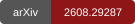
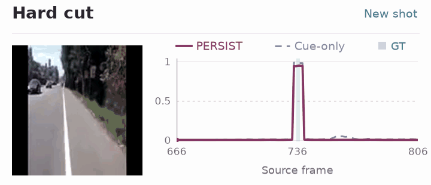
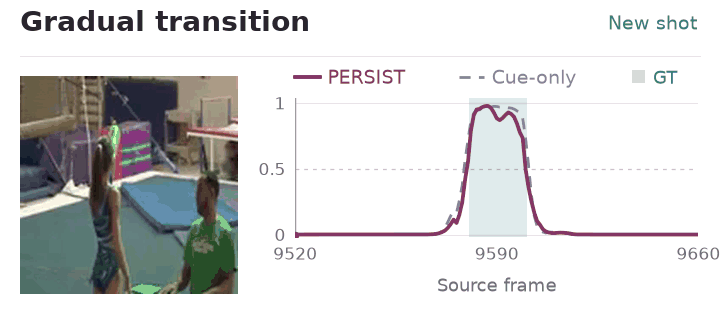
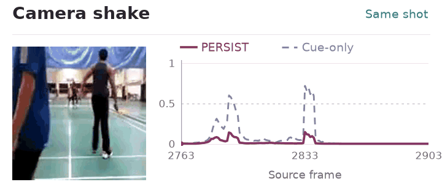
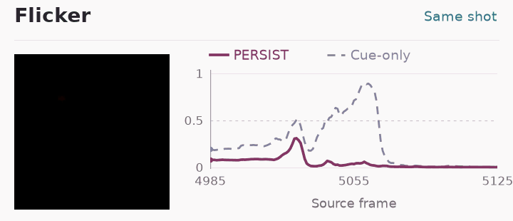
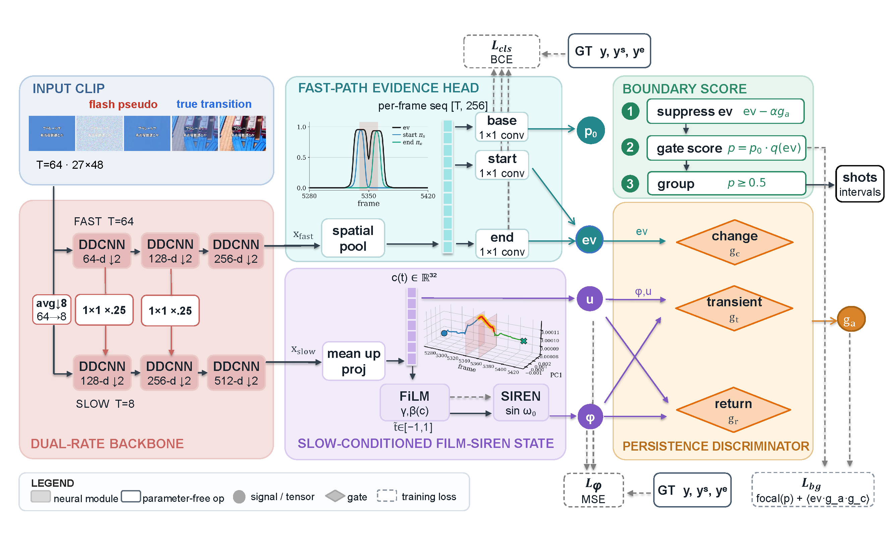

<p align="center">
  
</p>

<p align="center">
  <a href="https://linty5.github.io/">Tingyu&nbsp;Lin</a><sup>1</sup>,
  Christian&nbsp;Stippel<sup>1</sup>,
  Armin&nbsp;Dadras<sup>1,2</sup>,
  Jakob&nbsp;Zenzmaier<sup>3</sup>,<br>
  Florian&nbsp;Kleber<sup>1</sup>,
  Wolfgang&nbsp;Aigner<sup>2</sup>,
  Robert&nbsp;Sablatnig<sup>1</sup>
</p>

<p align="center">
  <sub>
    <sup>1</sup> Computer Vision Lab, TU Wien<br>
    <sup>2</sup> Institute of Creative\Media/Technologies, St. Pölten University of Applied Sciences<br>
    <sup>3</sup> Ludwig Boltzmann Institute for Digital History
  </sub>
</p>

<p align="center">
  <a href="https://arxiv.org/abs/2608.29287"></a>
  <a href="https://arxiv.org/abs/2608.29287"></a>
  <a href="https://huggingface.co/linty5/PERSIST"></a>
  <a href="LICENSE"></a>
</p>

<p align="center">
  <a href="https://arxiv.org/abs/2608.29287"><strong>Paper</strong></a> ·
  <a href="https://linty5.github.io/projects/persist/"><strong>Project page</strong></a> ·
  <a href="https://linty5.github.io/files/persist/PERSIST_BMVC2026_eposter.pdf"><strong>Poster</strong></a> ·
  <a href="https://linty5.github.io/projects/persist/#method"><strong>Method video</strong></a> ·
  <a href="https://huggingface.co/linty5/PERSIST"><strong>Model</strong></a>
</p>

<p align="center">
  <a href="#quick-start">Quick start</a> ·
  <a href="#see-what-persists">Examples</a> ·
  <a href="#across-four-benchmarks">Results</a> ·
  <a href="#training-and-reproduction">Training</a> ·
  <a href="#citation">Citation</a>
</p>

## Quick start

Install PERSIST and run it on a video (Python 3.10+):

```bash
pip install git+https://github.com/linty5/PERSIST.git@v1.1.0
persist_sbd video.mp4
```

The model downloads automatically from Hugging Face on first use and is cached for later runs.
Results are saved to `video.persist.json` as shot intervals and transitions.

PERSIST uses CUDA when available; otherwise, it runs on CPU.
For a smaller CPU-only installation, [install CPU PyTorch first](docs/USAGE.md#installation).

Process a folder and save JSON and CSV results:

```bash
persist_sbd videos/ -o results -f json,csv
```

## See what persists.

A sudden change alone does not mean a new shot: what separates a true boundary from a pseudo-event is whether the change lasts.

<table>
  <tr>
    <td></td>
    <td></td>
  </tr>
  <tr>
    <td></td>
    <td></td>
  </tr>
</table>

Real clips with recorded frame scores. The **cue-only baseline** uses the same backbone and training setup.

## Learning a persistence criterion.

Local change provides evidence. A continuous latent state helps distinguish lasting transitions from changes that soon return.

[](https://linty5.github.io/projects/persist/#method)

## Across four benchmarks

Published F1 at a shared threshold of 0.5.

| Method | ClipShots | BBC | AutoShot | HIST-GST12 |
|---|---:|---:|---:|---:|
| Pixel difference | 0.0351 | 0.0074 | 0.0683 | 0.0000 |
| HSV histogram | 0.5737 | 0.7786 | 0.6792 | 0.1544 |
| Edge change ratio | 0.3510 | 0.5552 | 0.3505 | 0.6019 |
| DeepSBD · AlexNet | 0.6843 | 0.8202 | 0.7539 | 0.8535 |
| DeepSBD · ResNet18 | 0.7555 | 0.8622 | 0.7303 | 0.8611 |
| TransNetV2 | 0.7793 | 0.9611 | **0.7993** | 0.9204 |
| **PERSIST** | **0.8023** | **0.9700** | 0.7953 | **0.9264** |

Best per column in bold. [Full protocols and oracle results ↗](https://arxiv.org/abs/2608.29287)

These are the paper's reported configurations, including its PERSIST ensemble;
the lightweight download contains one seed11 checkpoint.

## Model and downloads

| Model | Parameters | Weight size | Download |
|---|---:|---:|---|
| **PERSIST v1.1.0** · seed11 | 13.2M | 53 MB | [Hugging Face](https://huggingface.co/linty5/PERSIST) · [Model ZIP](https://github.com/linty5/PERSIST/releases/download/v1.1.0/persist-model-v1.1.0.zip) |

The model is downloaded automatically. For manual or offline setup, extract the ZIP
and pass its directory with `--model` or `persist_sbd.load(...)`.
The [v1.1.0 release](https://github.com/linty5/PERSIST/releases/tag/v1.1.0)
also provides a code-only wheel, source packages and checksums.

## Usage

Add `-r` to include subfolders, or `--per-frame` to save frame scores in JSON.
Outputs describe shot intervals and cut/gradual transitions; they do not split the video files.

From Python:

```python
import persist_sbd

model = persist_sbd.load()
result = model.detect("video.mp4")
print(result.shots)  # [(first_frame, last_frame), ...]
result.save_json("video.persist.json")
```

Reuse `model` for more videos. For decoded RGB frames, use `model.detect_frames(frames, fps=25)`.
See the [usage guide](docs/USAGE.md) for all options, offline use and the paper's inference protocol.

## Training and reproduction

For most applications, start with the released model, which performs well on historical footage and other challenging material. For domain-specific adaptation or research, use the [research implementation](https://github.com/linty5/PERSIST/tree/research). We will further improve training support.

## Citation

Tingyu Lin, Christian Stippel, Armin Dadras, Jakob Zenzmaier, Florian Kleber,
Wolfgang Aigner and Robert Sablatnig.

```bibtex
@inproceedings{lin2026persist,
  author    = {Lin, Tingyu and Stippel, Christian and Dadras, Armin and
               Zenzmaier, Jakob and Kleber, Florian and Aigner, Wolfgang and
               Sablatnig, Robert},
  title     = {{PERSIST}: Persistent-State Discrimination for Shot Boundary Detection},
  booktitle = {Proceedings of the British Machine Vision Conference (BMVC)},
  year      = {2026}
}
```

## License and acknowledgements

The code and released checkpoint use [Apache-2.0](LICENSE).

This distribution includes and modifies software from
[MMAction2](https://github.com/open-mmlab/mmaction2).
Copyright 2018-2019 Open-MMLab. All rights reserved.
Licensed under the Apache License, Version 2.0.

Portions of the dual-rate backbone are adapted from
[TransNetV2](https://github.com/soCzech/TransNetV2).
Copyright (c) 2020 Tomáš Souček.
Licensed under the MIT License. The complete license text is available in
[THIRD_PARTY_LICENSES/TransNetV2-LICENSE](THIRD_PARTY_LICENSES/TransNetV2-LICENSE).

The example clips come from ClipShots; their underlying media retain their
original rights.
