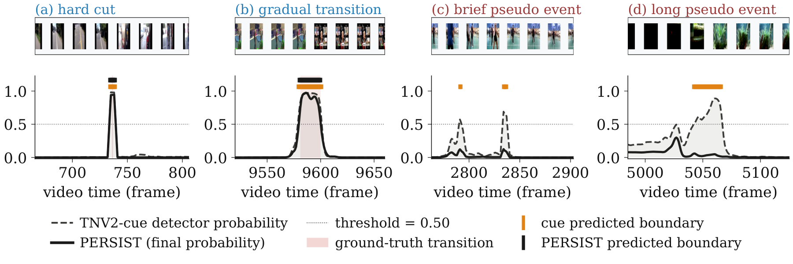

# PERSIST: Persistent-State Discrimination for Shot Boundary Detection

[](https://bmvc2026.bmva.org/)
[](LICENSE)

Official implementation of the BMVC 2026 paper **"PERSIST: Persistent-State Discrimination for Shot Boundary Detection"** by Tingyu Lin, Christian Stippel, Armin Dadras, Jakob Zenzmaier, Florian Kleber, Wolfgang Aigner, and Robert Sablatnig.

<p align="center">
  
</p>

## Overview

PERSIST detects a shot boundary only when local visual change is accompanied by a persistent update of the video's latent temporal state. It combines a dual-rate TransNetV2-style backbone, a FiLM-conditioned SIREN latent state, and three interpretable gates for local change, transient impulses, and return to the preceding trend.

## Repository layout

```text
configs/persist/   Training and evaluation configurations
checkpoints/       Local directory for downloaded release checkpoints
data/              Expected dataset layout
mmaction2/         MMAction2 v1.2.0 fork with the PERSIST implementation
tools_analysis/    Offline evaluation and analysis scripts
```

The main PERSIST components are:

- `mmaction2/mmaction/models/heads/sbd_ours_head.py`
- `mmaction2/mmaction/models/heads/sbd_slowfast_siren_trcs_head.py`
- `mmaction2/mmaction/models/backbones/slowfast_transnet_hybrid.py`
- `mmaction2/mmaction/models/backbones/transnetv2_dualrate.py`
- `mmaction2/mmaction/models/backbones/transnetv2_style.py`
- `mmaction2/mmaction/datasets/sbd_dataset.py`
- `mmaction2/mmaction/datasets/transforms/formatting.py` (`SBDPackActionInputs`)
- `mmaction2/mmaction/evaluation/metrics/sbd_metric.py`
- `mmaction2/mmaction/engine/hooks/sbd_siren_epoch_hook.py`
- `mmaction2/mmaction/engine/hooks/sbd_best_ckpt_name_hook.py`
- `mmaction2/tools/gen_eval_cfg.py`

Processed annotations, the pseudo-event diagnostic generator, the derived HISTORIAN-GST12 annotations, and the PERSIST Explorer are **coming soon**.

## Installation

The released models were tested on Linux with Python 3.8.18, PyTorch 2.4.1, CUDA 11.8, MMCV 2.1.0, and MMEngine 0.10.7.

```bash
conda create -n persist python=3.8 -y
conda activate persist
conda install pytorch==2.4.1 torchvision==0.19.1 torchaudio==2.4.1 pytorch-cuda=11.8 -c pytorch -c nvidia
pip install -U openmim
mim install "mmengine==0.10.7"
mim install "mmcv==2.1.0"
pip install -v -e ./mmaction2
```

MMCV may compile from source with this PyTorch/CUDA combination.

## Checkpoints

Each checkpoint is selected by validation F1. The validation-selected operating threshold is included in its filename. Model weights are distributed through [GitHub Releases](https://github.com/linty5/PERSIST/releases).

| Seed | Checkpoint | Validation threshold |
|---:|---|---:|
| 1 | [`persist_seed1_epoch7_valthr0.65.pth`](https://github.com/linty5/PERSIST/releases/latest/download/persist_seed1_epoch7_valthr0.65.pth) | 0.65 |
| 11 | [`persist_seed11_epoch10_valthr0.68.pth`](https://github.com/linty5/PERSIST/releases/latest/download/persist_seed11_epoch10_valthr0.68.pth) | 0.68 |
| 21 | [`persist_seed21_epoch8_valthr0.65.pth`](https://github.com/linty5/PERSIST/releases/latest/download/persist_seed21_epoch8_valthr0.65.pth) | 0.65 |

Download the checkpoints into the expected local directory:

```bash
mkdir -p checkpoints
wget -P checkpoints https://github.com/linty5/PERSIST/releases/latest/download/persist_seed1_epoch7_valthr0.65.pth
wget -P checkpoints https://github.com/linty5/PERSIST/releases/latest/download/persist_seed11_epoch10_valthr0.68.pth
wget -P checkpoints https://github.com/linty5/PERSIST/releases/latest/download/persist_seed21_epoch8_valthr0.65.pth
```

See [`checkpoints/README.md`](checkpoints/README.md) for checkpoint details.

## Data preparation

Download each benchmark from its original source and arrange the videos as follows:

```text
data/ClipShots/videos/
data/BBC_PlanetEarth/videos/
data/AutoShot/videos/test/
data/HISTORIAN/videos/
```

See [`data/README.md`](data/README.md) for the expected layout and the PERSIST source-file map. Processed annotation files are **coming soon**. Decoding caches are created under `data/_cache/`.

## Evaluation

Edit the **User settings** block at the top of `configs/persist/persist_eval.py` to select the dataset, checkpoint, threshold, seed, and output directory. Then run, from the repository root:

```bash
python mmaction2/tools/test.py configs/persist/persist_eval.py \
    checkpoints/persist_seed11_epoch10_valthr0.68.pth
```

`SBDMetric` reports results at the configured validation threshold, at a fixed threshold of 0.50, and at the oracle threshold for the evaluation split. Per-frame probabilities are saved to `<OUT_DIR>/eval_outputs/preds_prob.pkl`.

## Training

Edit `SEED` and `OUT_DIR` in the **User settings** block of `configs/persist/persist_train.py`, then launch distributed training:

```bash
bash mmaction2/tools/dist_train.sh configs/persist/persist_train.py 4
```

The paper setting uses ClipShots real transitions only, 10 epochs, an effective batch size of 224, and four NVIDIA A40 GPUs.

## Analysis

The scripts in `tools_analysis/` reproduce the offline metrics and analyses from saved `preds_prob.pkl` files. Registry-based scripts read predictions from `analysis_inputs/<dataset>/<model>/preds_prob.pkl`; set `PERSIST_ANALYSIS_ROOT` to use another workspace. Command-line options are documented with `--help` where available.

## Citation

```bibtex
@inproceedings{lin2026persist,
  author    = {Lin, Tingyu and Stippel, Christian and Dadras, Armin and Zenzmaier, Jakob and Kleber, Florian and Aigner, Wolfgang and Sablatnig, Robert},
  title     = {{PERSIST}: Persistent-State Discrimination for Shot Boundary Detection},
  booktitle = {Proceedings of the British Machine Vision Conference (BMVC)},
  year      = {2026}
}
```

## License and acknowledgements

Except where otherwise noted, PERSIST is released under the [Apache License 2.0](LICENSE). See [`NOTICE`](NOTICE) for attribution information.

The bundled [MMAction2 v1.2.0](https://github.com/open-mmlab/mmaction2) fork retains its upstream Apache License 2.0; see [`mmaction2/LICENSE`](mmaction2/LICENSE). Portions of the dual-rate backbone are adapted from the MIT-licensed [TransNetV2](https://github.com/soCzech/TransNetV2); see [`THIRD_PARTY_LICENSES/TransNetV2-LICENSE`](THIRD_PARTY_LICENSES/TransNetV2-LICENSE).

## Contact

Tingyu Lin, Computer Vision Lab, TU Wien, [tylin@cvl.tuwien.ac.at](mailto:tylin@cvl.tuwien.ac.at)
